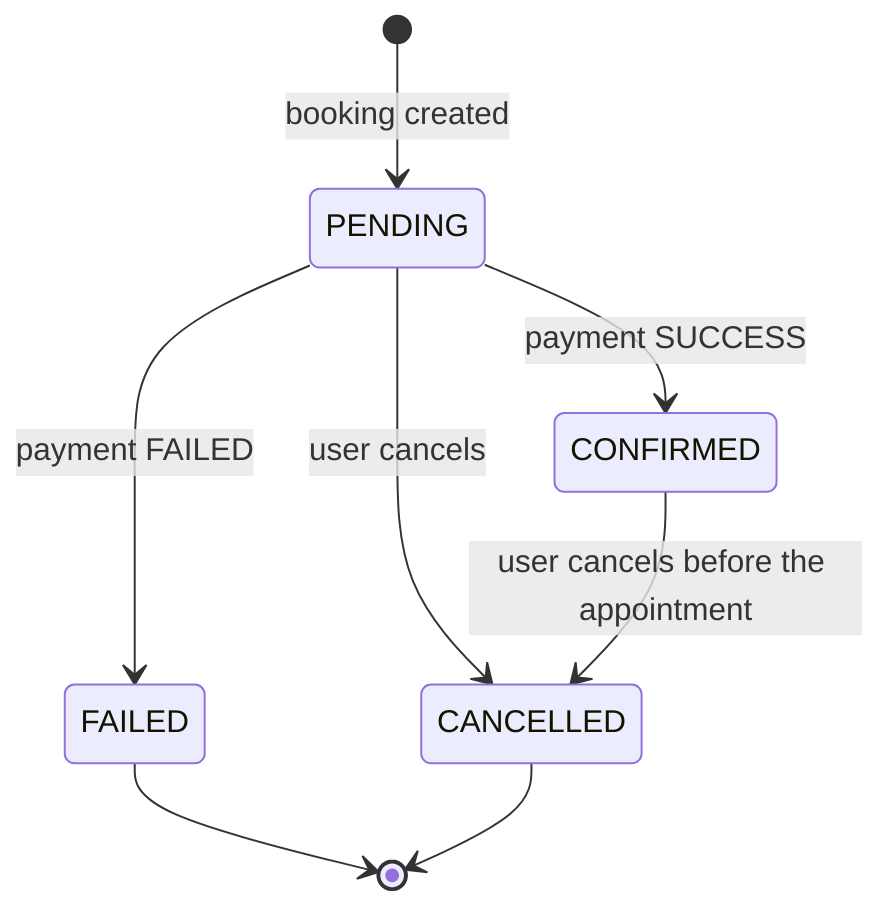
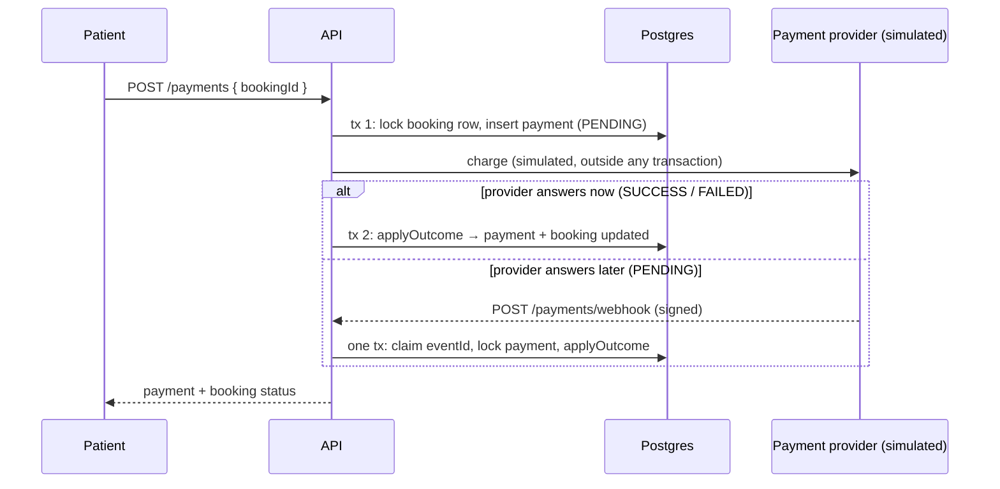
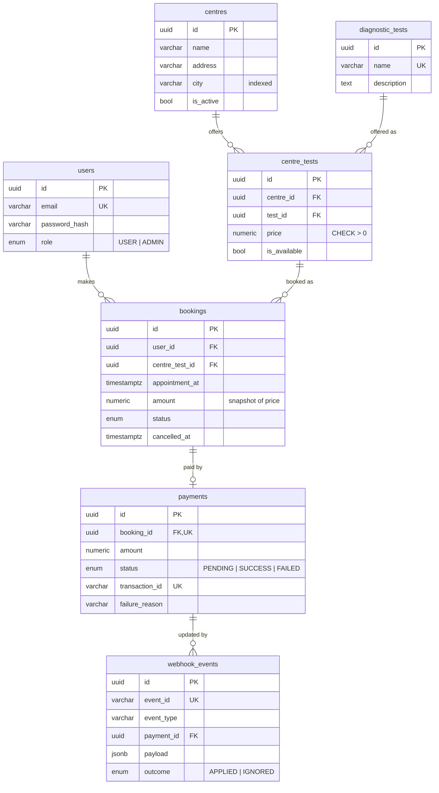

# EVE Healthcare — Diagnostic Test Booking & Payments API

A backend service where patients find diagnostic centres, book a test, pay through a simulated
gateway, and receive payment-status updates through an **idempotent, signed webhook**.

Built with **NestJS (TypeScript)**, **PostgreSQL**, **TypeORM** migrations, **Redis** and **BullMQ**.

| Requirement (assignment) | Where |
|---|---|
| 1. Signup, login, JWT, validation | `src/auth`, global `JwtAuthGuard`, `ValidationPipe` |
| 2. Centres, tests, prices | `src/catalog` — `centres`, `diagnostic_tests`, `centre_tests` (price per centre) |
| 3. Bookings with states | `src/bookings` — state machine in `booking-status.ts` |
| 4. `POST /payments/` simulated payment | `src/payments/payments.service.ts` |
| 5. `POST /payments/webhook/` idempotent | `src/payments/webhooks.service.ts` |
| 6. Edge cases | See [Edge cases](#edge-cases) — each one has a test |
| Bonus | Docker, Swagger, 120 tests, pagination, pino logs, rate limiting, Redis cache, BullMQ background webhook delivery with retries |

---

## Contents

1. [Quick start](#quick-start)
2. [Try the full flow](#try-the-full-flow)
3. [API endpoints](#api-endpoints)
4. [Payments and webhook design](#payments-and-webhook-design)
5. [Database design](#database-design)
6. [Edge cases](#edge-cases)
7. [Tests](#tests)
8. [Bonus features](#bonus-features)
9. [Assumptions](#assumptions)
10. [What I would improve with more time](#what-i-would-improve-with-more-time)
11. [Project structure](#project-structure)

---

## Quick start

Requirements: Docker. For running locally without Docker you also need Node.js 22.

### Option A — everything in Docker

```bash
docker compose up --build            # API on http://localhost:3000, runs migrations on start
docker compose exec app npm run seed:prod   # demo users, centres, tests, prices
```

### Option B — API on your machine, Postgres and Redis in Docker

```bash
npm install
cp .env.example .env
docker compose up -d postgres redis   # Postgres on :5433, Redis on :6380
npm run migration:run
npm run seed
npm run start:dev
```

- Swagger UI: **http://localhost:3000/docs** (OpenAPI JSON at `/docs-json`)
- Health check: `GET /health`

Seeded accounts:

| Role | Email | Password |
|---|---|---|
| ADMIN | `admin@eve.local` | `Admin12345` |
| USER | `patient@eve.local` | `Patient12345` |

> **Note:** this repo uses Node, so `package.json` plays the role of `requirements.txt` /
> `pyproject.toml` from the submission checklist.

---

## Try the full flow

```bash
BASE=http://localhost:3000

# 1. Log in as the seeded patient
TOKEN=$(curl -s -X POST $BASE/auth/login -H 'Content-Type: application/json' \
  -d '{"email":"patient@eve.local","password":"Patient12345"}' | jq -r .accessToken)

# 2. Find a centre in Gurugram and see its tests and prices
curl -s "$BASE/centres?city=gurugram" | jq '.data[0] | {id, name}'
curl -s "$BASE/centres/<centreId>" | jq '.tests'

# 3. Book a test
curl -s -X POST $BASE/bookings -H "Authorization: Bearer $TOKEN" -H 'Content-Type: application/json' \
  -d '{"centreId":"<centreId>","testId":"<testId>","appointmentAt":"2026-10-05T10:30:00+05:30"}'

# 4. Pay. Result is random (70% success) unless forced with simulateOutcome.
curl -s -X POST $BASE/payments/ -H "Authorization: Bearer $TOKEN" -H 'Content-Type: application/json' \
  -d '{"bookingId":"<bookingId>","simulateOutcome":"PENDING"}'

# 5. Deliver the provider's webhook yourself (signed with WEBHOOK_SECRET from .env).
#    Send the same --event twice to see the duplicate being ignored.
npm run webhook:send -- --transaction <transactionId> --amount 350 --event evt_demo_1
npm run webhook:send -- --transaction <transactionId> --amount 350 --event evt_demo_1
#    In Option A, run it inside the container so it uses the container's secret:
#    docker compose exec app node dist/scripts/send-webhook.js --transaction <id> --amount 350
```

With `simulateOutcome: "PENDING"` you don't have to send the webhook yourself: the simulated
provider sends it from a background job about 3 seconds later (see
[Background webhook delivery](#background-webhook-delivery-with-retries)).

---

## API endpoints

All request and response bodies are JSON. Auth column: **Public** = no token, **User** = needs
`Authorization: Bearer <token>`, **Admin** = token of an ADMIN user, **Signature** = signed webhook.

| Method | Path | Auth | Description |
|---|---|---|---|
| POST | `/auth/signup` | Public | Create an account → `201 { accessToken, user }` |
| POST | `/auth/login` | Public | Log in → `200 { accessToken, user }` |
| GET | `/auth/me` | User | Current user |
| GET | `/centres?city=&testId=&page=&limit=` | Public | Active centres, paginated, filterable |
| GET | `/centres/:id` | Public | Centre with its available tests and prices |
| GET | `/centres/:id/tests` | Public | Tests offered by a centre, with prices |
| POST | `/centres` | Admin | Create a centre |
| POST | `/centres/:id/tests` | Admin | Offer a test at a centre, with a price |
| GET | `/tests?search=&page=&limit=` | Public | Test catalogue, paginated |
| POST | `/tests` | Admin | Create a test |
| POST | `/bookings` | User | Book a test → `201`, status `PENDING` |
| GET | `/bookings?status=&page=&limit=` | User | Your bookings, newest first |
| GET | `/bookings/:id` | User | One of your bookings |
| PATCH | `/bookings/:id/cancel` | User | Cancel (safe to repeat) |
| POST | `/payments/` | User | Pay for a booking (simulated) |
| GET | `/payments/:id` | User | One of your payments |
| POST | `/payments/webhook/` | Signature | Payment-status update from the provider |
| GET | `/health` | Public | Liveness + DB check |

Both `/payments` and `/payments/` work (the same holds for the webhook path).

### Example requests and responses

**Signup** `POST /auth/signup`
```json
{ "name": "Sanjay Rawat", "email": "sanjay@example.com", "password": "Password123", "phone": "9876543210" }
```
```json
{
  "accessToken": "eyJhbGciOi...",
  "user": { "id": "…", "name": "Sanjay Rawat", "email": "sanjay@example.com", "phone": "9876543210", "role": "USER", "createdAt": "…" }
}
```

**Book** `POST /bookings` (User)
```json
{ "centreId": "…", "testId": "…", "appointmentAt": "2026-10-05T10:30:00+05:30" }
```
```json
{
  "id": "…", "userId": "…", "status": "PENDING", "appointmentAt": "2026-10-05T05:00:00.000Z",
  "amount": 350,
  "centre": { "id": "…", "name": "EVE Diagnostics — Cyber City", "address": "DLF Cyber City, Phase 2", "city": "Gurugram" },
  "test": { "id": "…", "name": "Complete Blood Count (CBC)" },
  "cancelledAt": null, "createdAt": "…", "updatedAt": "…"
}
```

**Pay** `POST /payments/` (User) — `simulateOutcome` is optional: `SUCCESS`, `FAILED` or `PENDING`
```json
{ "bookingId": "…", "simulateOutcome": "SUCCESS" }
```
```json
{
  "id": "…", "bookingId": "…", "amount": 350, "status": "SUCCESS",
  "transactionId": "txn_6353129b70e04ea7b6418231761e6271", "failureReason": null,
  "bookingStatus": "CONFIRMED", "createdAt": "…", "updatedAt": "…"
}
```
`201` for a new payment. Repeating the request for the same booking returns the **same**
payment with `200`, and nothing is charged twice.

**Webhook** `POST /payments/webhook/`
```http
x-webhook-timestamp: 1790533313
x-webhook-signature: sha256=<hex HMAC-SHA256 of "<timestamp>.<raw body>" with WEBHOOK_SECRET>
```
```json
{ "eventId": "evt_123", "eventType": "payment.succeeded", "data": { "transactionId": "txn_…", "amount": 350 } }
```
```json
{ "received": true, "duplicate": false, "outcome": "APPLIED", "paymentStatus": "SUCCESS" }
```
The same event again returns `{ "received": true, "duplicate": true }` and changes nothing.
`eventType` is `payment.succeeded` or `payment.failed`.

### Errors

Every error has the same shape:
```json
{ "statusCode": 409, "error": "Conflict", "message": "Booking is CANCELLED and cannot be paid", "path": "/payments", "timestamp": "…" }
```

| Code | When |
|---|---|
| 400 | Validation failed (`message` is a list), malformed UUID, unknown field, past appointment |
| 401 | Missing/invalid JWT, wrong login, bad or stale webhook signature |
| 403 | Logged in but not an admin, on an admin endpoint |
| 404 | Not found, **or it belongs to another user** (existence is not revealed) |
| 409 | Duplicate email / test / slot, illegal state change (e.g. pay a cancelled booking) |
| 422 | Webhook amount does not match the payment |
| 429 | Rate limit exceeded (`Retry-After` header set) |

---

## Payments and webhook design

This is the core of the assignment, so it gets the most care and the most tests.

### Booking state machine



All legal transitions live in one map (`src/bookings/booking-status.ts`). Every status change
goes through it, so a rule change is a one-line edit. `FAILED` and `CANCELLED` are terminal:
after a failed payment, the patient books again.

### Flow



- **One function applies a result**: `PaymentsService.applyOutcome()` is used by both
  `POST /payments` and the webhook. It only changes a `PENDING` payment. A repeat, a late event
  or a conflicting event is `IGNORED`, so a final state can never flip (for example, a
  `payment.failed` arriving after `payment.succeeded`).
- **Two steps with the gateway call in between**, like a real integration: the attempt is
  recorded first. If the process crashed during the gateway call, the payment would stay
  `PENDING` and the webhook would still settle it.
- **No double charge**: `payments.booking_id` is `UNIQUE`, and the booking row is locked
  (`SELECT … FOR UPDATE`) while the payment is created. Five concurrent requests produce exactly
  one payment (tested).

### Why the webhook is idempotent

Everything runs in **one transaction**, and the first statement claims the event:

```sql
INSERT INTO webhook_events (event_id, …) VALUES (…) ON CONFLICT (event_id) DO NOTHING RETURNING id;
```

- **No row returned**: this event was already processed. Reply `200 { duplicate: true }` and change nothing.
- **Same event delivered at the same moment**: the second insert waits on the unique index
  until the first transaction commits, then inserts nothing. A "SELECT first, then INSERT"
  check would let both through; this cannot.
- **Processing fails** (unknown transaction, amount mismatch, crash): the transaction rolls back,
  including the claimed `event_id`, so the provider's retry of the same event can still succeed.
- **Different events racing for the same payment**: the payment row is locked, so they run one
  after another. The first one wins and the other is `IGNORED`.

The webhook is authenticated by an **HMAC-SHA256 signature** over `"<timestamp>.<raw body>"`
(constant-time compare). Timestamps older than 5 minutes are rejected, so a captured request
can't be replayed later. It needs no JWT because the caller is the provider, not a user.

### Background webhook delivery with retries

For `PENDING` payments, the simulated provider (`src/payments/provider`) picks the result and
puts a **BullMQ job** on a Redis queue. A worker signs the webhook and POSTs it. Any non-2xx
response or network error is retried **up to 5 times with exponential backoff**. Every retry
re-sends the **same `eventId`**, so the webhook's idempotency makes retries safe. That includes
the case where our `200` was lost and the provider sends an event we already applied (tested).

---

## Database design



Decisions:

- **`centre_tests` junction with the price**: the same test costs different amounts at
  different centres. `UNIQUE (centre_id, test_id)` stops a test from being listed twice at a centre.
- **`bookings.amount` is a snapshot** of the price at booking time, so a later price change
  doesn't change what the patient owes (tested).
- **Partial unique index** `(user_id, centre_test_id, appointment_at) WHERE status IN ('PENDING','CONFIRMED')`
  blocks duplicate live bookings for the same slot. A cancelled slot can be booked again.
- **Constraints enforce the invariants, not only the application code**: `UNIQUE(payments.booking_id)`,
  `UNIQUE(webhook_events.event_id)`, `UNIQUE(payments.transaction_id)`, `CHECK (price > 0)`,
  `CHECK (amount > 0)`, and FKs with `ON DELETE RESTRICT` (no silent loss of booking history).
- `NUMERIC(10,2)` for money (no float rounding), `timestamptz` for times, UUID keys (not guessable).
- Indexes support the real queries: `bookings (user_id, created_at)` for "my bookings",
  `centres (city)`, `centre_tests (test_id)`, `webhook_events (payment_id)`.
- Schema changes go through **TypeORM migrations** (`src/database/migrations`), never
  `synchronize`. The e2e suite rebuilds the test DB from migrations on every run, so migrations
  are tested too.

---

## Edge cases

Each of these has an automated test.

| Case | Behaviour |
|---|---|
| Same webhook delivered twice / 5× concurrently | Applied once, other deliveries `200 duplicate` |
| `payment.failed` after `payment.succeeded` | `IGNORED`, booking stays `CONFIRMED` |
| Conflicting events racing | Exactly one wins; payment and booking always agree |
| Webhook with bad signature / stale timestamp / tampered body | `401`, nothing stored |
| Webhook for unknown transaction | `404`, event not stored, so a later retry can succeed |
| Webhook amount ≠ payment amount | `422`, nothing changed |
| Payment succeeds after the user cancelled | Payment `SUCCESS`, booking stays `CANCELLED`, refund logged |
| Double-click / concurrent `POST /payments` | One payment row; repeats return it with `200` |
| Pay for a cancelled, failed or past booking | `409` |
| Invalid / unknown booking ID | `400` / `404` |
| Another user's booking or payment (read, pay or cancel) | `404` |
| Normal user calls an admin endpoint | `403` |
| Missing, malformed or wrong JWT | `401` |
| Past appointment, > 90 days ahead, no timezone | `400` |
| Test not offered / unavailable / centre inactive | `404` |
| Duplicate booking for the same slot | `409` (allowed again after cancelling) |
| Cancel twice | Second call is a no-op `200` |
| Cancel a confirmed booking after its appointment | `409` |
| Duplicate email (any letter case) | `409` |
| Wrong password vs unknown email | Same `401` message, so emails can't be enumerated (a dummy bcrypt compare also keeps timing similar) |
| Unknown fields in a body (e.g. `role: "ADMIN"` at signup) | `400` |
| Brute-force login | `429` after 10/min per IP |

---

## Tests

```bash
docker compose up -d postgres redis   # tests use a separate DB (eve_healthcare_test) and Redis DB 1
npm test                              # 27 unit tests
npm run test:e2e                      # 93 end-to-end tests against real Postgres and Redis
```

- **Unit**: state machine transitions, webhook signature (tampering, replay, wrong secret),
  payment simulator, cache service (including Redis being down).
- **End-to-end**: the real app over HTTP against real Postgres and Redis. Idempotency depends on
  database constraints and locks, so mocking the DB would not prove it. Includes concurrency
  tests (`Promise.all`) and the background-retry tests, which use a small proxy that fails on
  purpose.

---

## Bonus features

| Feature | Details |
|---|---|
| Docker & compose | Multi-stage image, non-root user, migrations run on start |
| Swagger / OpenAPI | `/docs`, generated from the DTOs and validation rules |
| Background jobs + retry | BullMQ webhook delivery with exponential backoff (above) |
| Redis caching | Public catalogue reads are cached (60 s TTL). Any catalogue write invalidates them by bumping a namespace version: one `INCR`, no key scans. If Redis is down, reads fall back to the DB. Booking never reads the cache, so it always uses the current price. |
| Rate limiting | 100 req/min per IP globally; 10/min on signup/login. The webhook is exempt. |
| Structured logging | pino JSON logs, one line per request, `x-request-id` header, auth and signature headers redacted |
| Pagination | `page` / `limit` (max 100) with `meta: { page, limit, total, totalPages }` |
| Config validation | The app refuses to start if an env var is missing or invalid |

---

## Assumptions

1. **Roles**: two roles, `USER` and `ADMIN`. Admins manage the catalogue. Seeding is the only
   way to create an admin (there is no admin signup).
2. **One payment per booking.** A failed payment makes the booking `FAILED`; the patient books
   again rather than retrying the same booking. This keeps "no duplicate payments" enforceable
   by a single unique constraint.
3. **Simulated payment**: random, 70% success (`PAYMENT_SUCCESS_RATE`). The optional
   `simulateOutcome` field forces `SUCCESS`, `FAILED` or `PENDING` for demos and tests. It would
   not exist with a real gateway.
4. **Refunds are out of scope.** Cancelling a confirmed booking, or a success that arrives
   after cancelling, logs "refund required" instead of refunding.
5. **No time slots or capacity**: any future time within 90 days is bookable. Appointment times
   must include a timezone offset, so there is no guessing.
6. Single currency (INR). No email or SMS notifications.
7. Other users' resources return `404` rather than `403`, so their existence is not revealed.

---

## What I would improve with more time

- **Refunds**: a `REFUND_PENDING → REFUNDED` flow for cancelled paid bookings, driven by a queue job.
- **Slots and capacity** per centre, with booking holds that expire (a repeatable job that
  moves stale `PENDING` bookings to an `EXPIRED` state).
- **Payment retries on the same booking** (several attempts per booking, with a partial unique
  index allowing only one `SUCCESS`).
- **Refresh tokens and logout** (token revocation list in Redis).
- **Transactional outbox** for domain events (booking confirmed → notifications).
- Rate limiting and throttler storage in Redis, so limits hold across multiple instances.
- Admin endpoints to update or deactivate centres and prices, plus audit logging.
- CI pipeline (lint, tests, image build) and test coverage reports.

---

## Project structure

```
src/
├── auth/            signup, login, JWT
├── users/           user entity + service
├── catalog/         centres, tests, centre_tests (prices), caching
├── bookings/        bookings + state machine
├── payments/        payments, webhook, signature guard, simulator
│   └── provider/    simulated provider: BullMQ webhook delivery + retries
├── redis/           Redis client + cache service
├── common/          guards (JWT, roles), decorators, pagination, error filter
├── database/        TypeORM config, migrations, pg error helpers
├── scripts/         seed.ts, send-webhook.ts
├── config/          env validation
├── app.module.ts / app.setup.ts / main.ts / swagger.ts
test/                e2e tests + helpers (test/support)
```

### Useful scripts

| Command | What it does |
|---|---|
| `npm run start:dev` | Start with watch mode |
| `npm run migration:generate -- src/database/migrations/Name` | Create a migration from entity changes |
| `npm run migration:run` / `migration:revert` | Apply / undo migrations |
| `npm run seed` | Load demo data (safe to re-run) |
| `npm run webhook:send -- --transaction … --amount …` | Send a signed webhook |
| `npm test` / `npm run test:e2e` | Unit / end-to-end tests |
